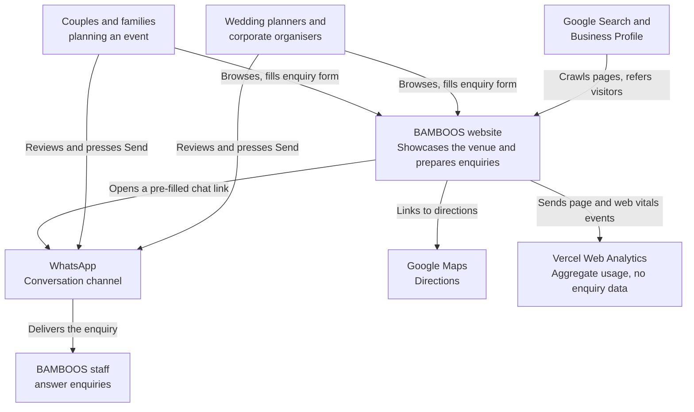
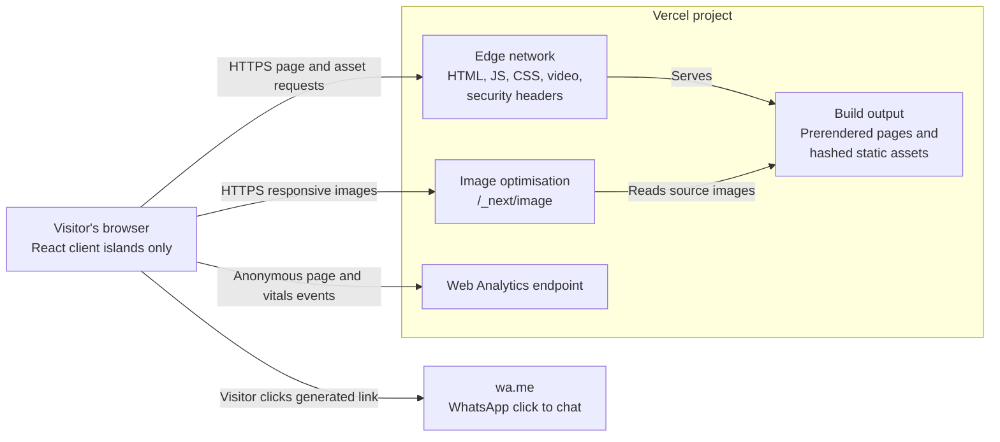
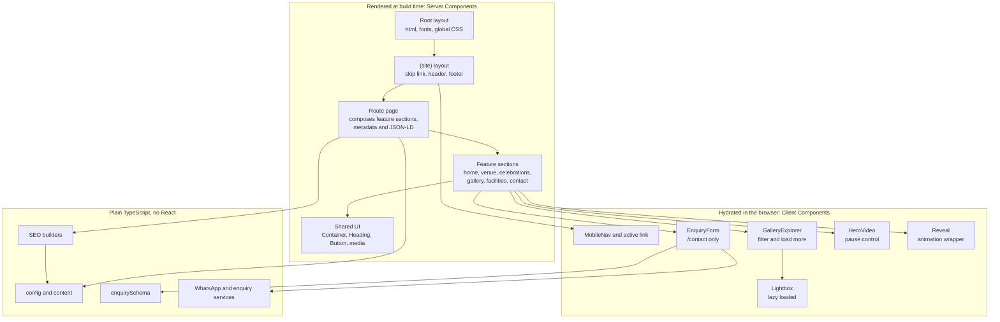
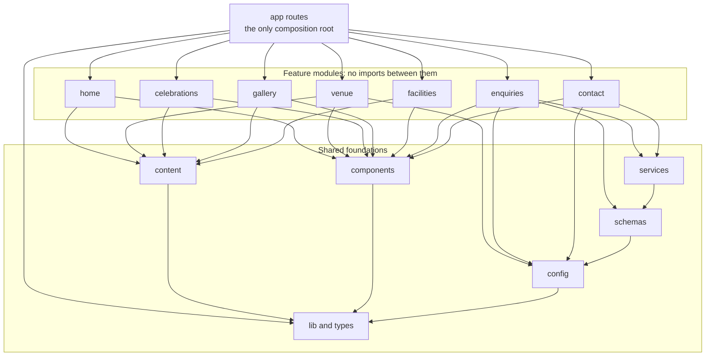
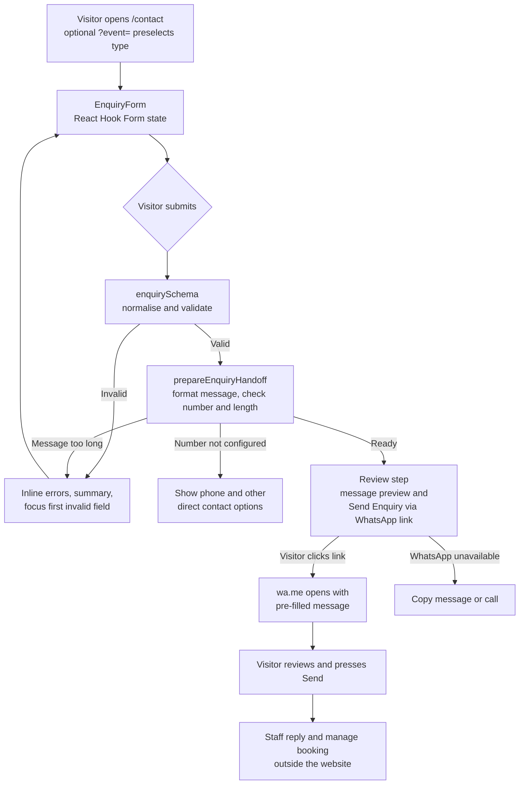
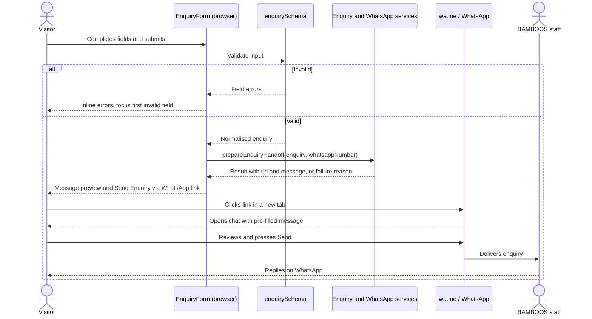
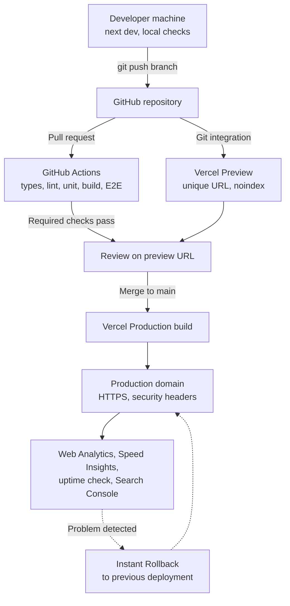
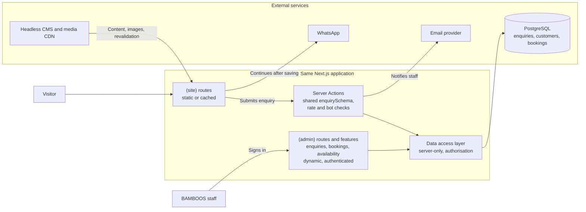

# BAMBOOS Premium Auditorium Website — Solution Architecture

| | |
|---|---|
| **Status** | Implemented as a frontend. Awaiting verified business facts and media |
| **Phase** | Release 1 frontend built. See [README.md](README.md) for what remains |
| **Visual direction** | The threshold: see [ADR-011](ADR/ADR-011-threshold-visual-direction.md). Some component names in sections 8 to 10 predate it |
| **Date** | 5 November 2026 |
| **Baseline** | Next.js 16.4.5, React 19.3.0, Tailwind CSS 4.3.4, TypeScript 5.9.3 |

**Related documents:** [Scope](PROJECT_SCOPE.md) · [Tech stack](TECH_STACK.md) · [Data model](DATA_MODEL.md) · [API design](API_DESIGN.md) · [Security](SECURITY.md) · [Testing](TESTING_STRATEGY.md) · [Deployment](DEPLOYMENT.md) · [Decision records](ADR/README.md)

---

## 1. Project overview

BAMBOOS is an auditorium, wedding venue and event destination in Aluva, Ernakulam, Kerala. The website must present the venue at a premium standard, be found in local search, and turn visitors into **booking enquiries**.

The core architectural insight is that this product is a **content-led, read-mostly website with exactly one write path**: the enquiry. That path needs no server in its first release, because the visitor hands the enquiry to WhatsApp themselves.

So the first release is a **fully prerendered site with no database, no backend and no request-time rendering**. It is structured so that a backend can be added later without restructuring what already exists.

### Summary for the client

- Pages are built in advance, so they load quickly and have very little to go wrong or attack.
- The enquiry form sends nothing to a BAMBOOS server. It prepares a WhatsApp message that the visitor reviews and sends.
- An enquiry is a request for information. Only BAMBOOS staff can confirm a booking.
- Capacity, amenities and contact details appear only after BAMBOOS verifies them. An unverified fact stays off the site, and launch is blocked until required facts are supplied.
- Admin tools, availability calendars and booking management can be added later as an extension to this structure.

---

## 2. Architectural goals

| Priority | Quality | What it means here | How it is verified |
|---|---|---|---|
| 1 | **Conversion** | A visitor can reach WhatsApp or a phone number from any page, on any device | E2E tests; click-through analytics |
| 2 | **Performance** | An image-heavy site still meets Core Web Vitals on mid-range mobile | Lighthouse CI; field data |
| 3 | **Local discoverability** | Each page targets specific local search intent, with accurate structured data | Rich Results Test; Search Console |
| 4 | **Trustworthy content** | One source of truth, and no unverified claims | Launch content check |
| 5 | **Accessibility** | WCAG 2.2 AA | axe in E2E; manual keyboard and screen reader pass |
| 6 | **Maintainability** | A new developer can find and change anything quickly; boundaries are enforced by tooling | ESLint boundary rules; strict TypeScript |
| 7 | **Evolvability** | A backend, CMS or admin area can be added without restructuring | [Section 21](#21-scalability-strategy) migration paths |
| 8 | **Low running cost** | No server rendering, no database and no paid services at launch beyond hosting | Static-only build gate |

**Explicit non-goals for release 1:** online payment, live availability, accounts, booking confirmation, and multi-language content.

---

## 3. Project audit baseline

Audited on 5 November 2026. Commands were run against the working tree, with the source unchanged.

| Area | Finding | Assessment |
|---|---|---|
| Framework | `next@16.4.5`, `react@19.3.0`, `react-dom@19.3.0`, exact pins | Good. Matches the proposed stack |
| Styling | `tailwindcss@4.3.4` through `@tailwindcss/turbopack`, configured in `next.config.ts`. No `postcss.config` and no `tailwind.config` | Works. The bundled Next.js guide documents `@tailwindcss/postcss` instead, so this is recorded as low risk (see [TECH_STACK.md](TECH_STACK.md)) |
| TypeScript | `strict: true`, `@/*` maps to `./src/*` | Good. Add `noUncheckedIndexedAccess` at implementation |
| Linting | ESLint 9 flat config with `next/core-web-vitals` and `next/typescript` | Good. `eslint-plugin-import` and `eslint-plugin-jsx-a11y` are already installed transitively |
| Source | Scaffold only: `src/app/{layout,page}.tsx`, `globals.css`, default SVGs in `public/` | Nothing to preserve or migrate |
| Scripts | `dev`, `build`, `start`, `lint`. No `test` or `typecheck` script | Add at implementation |
| Baseline health | `tsc --noEmit` passes, `npm run lint` passes, `next build` passes with `/` static, `npm audit --omit=dev` finds 0 vulnerabilities | Healthy |
| Baseline JS | About 180 kB gzipped across all scaffold chunks (a total, so an upper bound for one route) | Reference point for the budgets in [Section 16](#16-performance-architecture) |
| Git | Branch `master`, one commit, **no remote** | Create the GitHub repository and rename the branch to `main` |

**Defects to fix when implementation starts** (deliberately left alone in this phase):

1. `.gitignore` has `.env*`, which also ignores `.env.example`. Add `!.env.example`.
2. `body { font-family: Arial… }` in `globals.css` overrides the loaded Geist font.
3. `metadata` still says "Create Next App".
4. `@types/node` is `^20` while the development machine runs Node 24. Pin one Node version with `.nvmrc`, `engines` and the Vercel project setting.
5. `README.md` was scaffold boilerplate. It has been replaced in this phase.

**Status of these defects:** all five were fixed during implementation.

**Inputs still missing:** verified business facts, photography, video, logo and brand guidelines, domain name, and the WhatsApp number. See the [content register](PROJECT_SCOPE.md#8-content-verification-register).

---

## 4. Architecture style

**Feature-based modular monolith, server-first, statically rendered.** One Next.js application and one deployment, organised around business capabilities with import boundaries enforced by tooling.

| Alternative | Verdict | Reason |
|---|---|---|
| Layer-only folders (`components/`, `hooks/`, …) | Rejected | Business capabilities scatter across folders as the site grows |
| **Feature-based modular monolith** | **Selected** | Clear ownership and low ceremony, and a feature can grow a backend in place |
| Separate frontend and backend | Rejected | No requirement justifies a second deployment. Next.js can host server code when one exists |
| Microservices | Rejected | One write path and one team. All cost, no benefit |
| Full Clean or hexagonal architecture | Rejected | Interfaces with a single implementation add indirection without value. Only the useful parts are kept: dependencies point inward, and business logic stays out of UI |
| Static site generator or WordPress | Rejected | See [TECH_STACK.md](TECH_STACK.md) and [ADR-001](ADR/ADR-001-modular-monolith-architecture.md) |

**Principles applied**

- **Single responsibility:** routes compose, features present, services compute, schemas validate, config and content hold facts.
- **DRY for facts:** every business fact has exactly one home.
- **Dependency inversion only where useful:** the only seams are the `get*()` content functions and the enquiry service function. There are no repository classes, no DI container and no port interfaces.
- **Open for extension:** a future backend adds server code and an `(admin)` route group. Public feature modules stay as they are.

See [ADR-001](ADR/ADR-001-modular-monolith-architecture.md).

---

## 5. System context

Diagram 1 shows who and what the system interacts with. In release 1 the only external system that receives visitor data is WhatsApp, and only when the visitor chooses to go there.



---

## 6. Container architecture

Diagram 2 shows what is actually deployed. There is no application server, because the build gate ensures no route renders per request.

The one server-side runtime component is Vercel's image optimiser, which resizes images on demand and caches the results.



---

## 7. Architectural layers

| Layer | Location | Responsibility | May depend on |
|---|---|---|---|
| **A. Presentation** | `src/app/`, `src/components/layout/` | Page composition, layouts, navigation, boundaries | Features, shared UI, config, SEO, content |
| **B. Feature** | `src/features/*` | Business-specific UI and logic for one capability | Shared UI, config, content, services, schemas, lib, types |
| **C. Shared components** | `src/components/{ui,motion,media}/` | Reusable, business-agnostic UI | `lib`, types |
| **D. Configuration** | `src/config/` | Single facts: business identity, contact, WhatsApp, navigation, SEO defaults, social links, environment | Types |
| **E. Service** | `src/services/` | WhatsApp URL generation, enquiry message formatting and handoff; future integrations | Schemas (types), types |
| **F. Validation** | `src/schemas/` | Enquiry schemas, normalisation, inferred types | Config (event types) |
| **G. SEO** | `src/lib/seo/`, `src/app/sitemap.ts`, `src/app/robots.ts` | Metadata builders, JSON-LD builders, sitemap, robots, canonical URLs, Open Graph | Config, content, types |
| **H. Testing** | Colocated `*.test.ts(x)`, `tests/e2e/` | Unit, component, integration, E2E | Everything, nothing depends on it |

`src/content/` holds structured venue data and belongs with the configuration concern. It is separate from `config/` for one important reason, explained in [Section 12](#12-data-architecture): it imports image files.

---

## 8. Component architecture

Diagram 3 shows how a request's page is assembled. **Server Components are the default.** Client Components exist only for the islands marked below, so the rest of the page ships no component JavaScript.



### Client Component policy

A component may be a Client Component only if it needs state, effects, browser APIs or event handlers. The `"use client"` boundary goes as low as possible, and server-rendered content is passed in as `children` where possible.

| Island | Why it must run in the browser | Loading strategy |
|---|---|---|
| `MobileNav`, `NavLink` | Open state; current path | Included with the site layout, kept small |
| `GalleryExplorer` | Filter state | Only on `/gallery` and the gallery teaser |
| `Lightbox` | Native `<dialog>`, keyboard handling | `next/dynamic`, on first open |
| `EnquiryForm` | Validation and link generation | Only on `/contact` |
| `HeroVideo` | Playback, pause, reduced motion | Only on pages with a video |
| `Reveal` | Viewport-triggered animation | CSS first, Motion only if justified |

See [ADR-003](ADR/ADR-003-server-components-first.md).

---

## 9. Feature module architecture

Each feature has a public API in `index.ts`. Only what routes need is exported, and internals stay private. Heavy client code gets its own entry point (`@/features/enquiries/form`, `@/features/gallery/explorer`), because bundle measurement showed a shared barrel pulled Zod into every page that used the enquiry callout.

| Feature | Responsibility | Client islands | Explicitly not responsible for |
|---|---|---|---|
| `home` | Hero and home-only sections (welcome, positioning) | `HeroVideo` | Rendering other features' sections. The route composes those |
| `venue` | Auditorium story, halls, capacity and infrastructure | None | Amenity list (`facilities`) |
| `celebrations` | Event category listing and detail pages | None | Gallery behaviour; enquiry form |
| `gallery` | Gallery grid, category filter, lightbox, video list | `GalleryExplorer`, `Lightbox` | Choosing which assets exist (`content`) |
| `facilities` | Amenities and facilities presentation | None | Venue capacity |
| `enquiries` | Enquiry form, preselected event, handoff states, enquiry/booking disclaimer | `EnquiryForm` | URL construction (`services`), rules (`schemas`) |
| `contact` | Address, map facade, directions, call and chat actions | Map facade | Enquiry form logic |

**Internal shape.** Create only what a feature needs, and never create empty folders:

```text
features/gallery/
├── index.ts                  # Public API
├── components/
│   ├── gallery-section.tsx
│   ├── gallery-explorer.tsx  # "use client"
│   └── lightbox.tsx          # "use client", loaded on demand
└── lib/
    ├── filter-gallery.ts     # Pure logic
    └── filter-gallery.test.ts
```

### Feature dependency rules

Diagram 4 shows the actual allowed dependencies. **Features never import other features.** When a page needs two features, the route composes them. For example, the home route renders `HomeHero` from `home`, `CelebrationHighlights` from `celebrations` and `GalleryTeaser` from `gallery`.



Omitted from the diagram for legibility: every module may use `lib` and `types`, and routes and the site layout may also use `components`, `config` and `content` directly.

**How a shared need is resolved**

| Need | Resolution |
|---|---|
| Two features need the same data | Move it to `content/` or `config/` |
| Two features need the same UI | Promote it to `components/` once it has no business knowledge |
| A celebration page links to the form | A plain link to `/contact?event=wedding#enquiry`, with no import |
| A page needs both sections | The route composes both |

---

## 10. Folder structure

This is the **target structure**. Folders are created only when their first file is needed.

```text
bamboo_website/
├── .github/workflows/ci.yml        # Quality gates
├── ADR/                            # Architecture decision records
├── public/
│   └── media/video/                # Self-hosted video and captions
├── src/
│   ├── app/
│   │   ├── layout.tsx              # Root: <html>, fonts, globals.css, metadataBase
│   │   ├── globals.css             # Tailwind import and design tokens
│   │   ├── not-found.tsx           # Branded 404
│   │   ├── global-error.tsx        # Last-resort boundary
│   │   ├── sitemap.ts
│   │   ├── robots.ts
│   │   ├── opengraph-image.jpg     # Site-wide social image
│   │   └── (site)/                 # Public website chrome
│   │       ├── layout.tsx          # Skip link, header, footer, WhatsApp action
│   │       ├── error.tsx           # Route-level recovery UI
│   │       ├── page.tsx            # /
│   │       ├── venue/page.tsx
│   │       ├── celebrations/
│   │       │   ├── page.tsx
│   │       │   └── [slug]/page.tsx
│   │       ├── gallery/page.tsx
│   │       ├── facilities/page.tsx
│   │       ├── contact/page.tsx
│   │       └── privacy/page.tsx
│   ├── features/
│   │   ├── home/
│   │   ├── venue/
│   │   ├── celebrations/
│   │   ├── gallery/
│   │   ├── facilities/
│   │   ├── enquiries/
│   │   └── contact/
│   ├── components/
│   │   ├── ui/                     # Button, Container, Heading, SectionHeading
│   │   ├── layout/                 # Header, Footer, MobileNav, SkipLink
│   │   ├── motion/                 # Reveal
│   │   └── media/                  # ResponsiveImage, VideoPlayer
│   ├── config/
│   │   ├── business.ts             # Name, address, geo, hours
│   │   ├── contact.ts              # Phone, email, WhatsApp number
│   │   ├── event-types.ts          # Event type ids and labels (no images)
│   │   ├── navigation.ts
│   │   ├── seo.ts
│   │   ├── social.ts
│   │   └── env.ts                  # Validated environment access
│   ├── content/
│   │   ├── venue.ts
│   │   ├── facilities.ts
│   │   ├── celebrations.ts
│   │   └── gallery.ts
│   ├── assets/media/               # Statically imported images (see Section 15)
│   ├── services/
│   │   ├── whatsapp.ts
│   │   └── enquiry-handoff.ts
│   ├── schemas/
│   │   └── enquiry.ts
│   ├── types/
│   │   └── domain.ts
│   ├── hooks/                      # Only hooks used by two or more features
│   └── lib/
│       ├── seo/                    # metadata.ts, json-ld.ts
│       └── utils.ts
├── tests/e2e/                      # Playwright journeys
├── .env.example
├── AGENTS.md
├── eslint.config.mjs
├── next.config.ts
├── playwright.config.ts
├── vitest.config.mts
└── *.md                            # Project documentation
```

### Directory contracts

| Directory | Responsibility | Belongs inside | Does **not** belong | Who can depend on it |
|---|---|---|---|---|
| `src/app/` | Routing and composition | Pages, layouts, boundaries, metadata routes | Business logic, reusable components, hardcoded facts | Nothing imports from it |
| `src/features/*` | One business capability | Feature UI, feature logic, feature hooks | Imports from other features; global facts | `src/app` only, through `index.ts` |
| `src/components/ui` | Business-agnostic primitives | Button, Container, Heading | Business copy, config imports, data | Features, layout, app |
| `src/components/layout` | Site chrome | Header, Footer, MobileNav | Page sections | `src/app` |
| `src/components/motion` | Animation wrappers | `Reveal` | Business logic, LCP element animation | Features, app |
| `src/components/media` | Image and video primitives | `ResponsiveImage`, `VideoPlayer` | Specific business images | Features, app |
| `src/config` | Single business and app facts | Typed constants, validated env | Images, React, secrets | Anything except `types` and `lib` |
| `src/content` | Structured venue data | Lists of facilities, celebrations and gallery items | React, presentation, client imports | Server Components in features and app, `lib/seo` |
| `src/assets/media` | Source images | Optimised web masters | Unlicensed images, RAW files, video | `src/content` and brand components |
| `public/media/video` | Files that must keep a stable URL | Video, captions | Images that could be statically imported | Referenced by URL |
| `src/services` | Framework-free operations | URL generation, message formatting, later integrations | React, DOM access, UI strings beyond the message template | Features, future server code |
| `src/schemas` | Runtime validation | Zod schemas and inferred types | Network calls, React | Features, services, future server code |
| `src/types` | Shared domain types | Entity types used across modules | Types used by one module; runtime code | Anything |
| `src/hooks` | Shared hooks | Hooks used by two or more features | Single-feature hooks | Features, components |
| `src/lib` | Generic helpers and SEO builders | `cn`, metadata and JSON-LD builders | Feature logic; a catch-all "utils" dumping ground | Anything above it |
| `tests/e2e` | User journeys | Playwright specs | Unit tests, which are colocated | Nothing |

### Future expansion

```text
src/
├── app/
│   ├── (site)/                 # Unchanged
│   ├── (admin)/admin/          # Added: authenticated dashboard
│   └── api/                    # Added only if a non-web client needs HTTP
├── features/
│   ├── enquiry-management/     # Added
│   └── bookings/               # Added
└── server/                     # Added: data access layer, "server-only"
    ├── db/
    └── auth/
```

---

## 11. Dependency rules

1. Dependencies point downward: `app → features → components / services / schemas / content / config → lib / types`.
2. **Features must not import other features** or `app`.
3. Feature imports go through the public `index.ts`.
4. `components/ui` must not import `config`, `content`, `features` or `services`.
5. `services` and `schemas` must not import React or touch the DOM, so they can run on a future server.
6. Client Components must not import `src/content`, or image data would be bundled into browser JavaScript. Data arrives as props.
7. Business facts are imported from `config` or `content`, and never retyped.
8. No circular dependencies.

**Rules are enforced by tooling, not by convention.** ESLint can do this with no new dependencies, using the built-in `no-restricted-imports` rule and the already-installed `import/no-cycle`. Example to adopt at implementation:

```js
// eslint.config.mjs (illustrative extract, not yet applied)
// Files inside a feature import each other with relative paths, so this rule only catches cross-feature imports.
{
  files: ["src/features/**"],
  rules: {
    "no-restricted-imports": ["error", { patterns: [
      { group: ["@/app/*"], message: "Features must not depend on routes." },
      { group: ["@/features/*"], message: "Features must not import other features. Compose them in the route." },
    ]}],
    "import/no-cycle": "error",
  },
}
```

---

## 12. Data architecture

Full models are in [DATA_MODEL.md](DATA_MODEL.md).

| Information | Storage | Why | With a CMS or database |
|---|---|---|---|
| Business name, address, geo, hours | `config/business.ts` | Single facts, reviewed in pull requests | Could stay in code |
| Phone, email, WhatsApp number | `config/contact.ts` | Public facts, not secrets | Could become CMS settings |
| Event type ids and labels | `config/event-types.ts` | Shared with the browser form, so it must not import images | Stays in code |
| Venue, facilities, celebrations, gallery | `content/*.ts` | Typed, can reference images, checked at build | Moves to CMS |
| Site URL, analytics switch | Environment variables | These genuinely vary by environment | Unchanged |
| Secrets | None exist | No server-side integrations yet | Environment variables, server only |
| Enquiries | Not stored by the website | Avoids holding personal data until the business needs it | Database |

**No database in release 1.** Nothing needs to be queried, updated at runtime or kept by the site. See [ADR-004](ADR/ADR-004-static-configuration-instead-of-database.md).

**How unverified facts are handled.** Facts that BAMBOOS must confirm are typed as nullable, and `null` means "not verified". The rule is applied the same way everywhere:

- UI omits the item, and never shows a placeholder or a guess.
- JSON-LD omits the property, or the whole block if a required property is missing.
- `npm run check:launch` fails if any launch-required fact is still `null`. It gates production releases.

**The one seam for future data sources.** Routes read content through small async functions such as `getCelebrations()`. Today they return constants. When a CMS arrives, only those functions change. Routes `await` them and pass plain props, so feature components keep working and remain easy to test.

---

## 13. Routing architecture

| Route | Responsibility | Rendering | SEO intent | Metadata |
|---|---|---|---|---|
| `/` | Positioning, highlights, primary CTAs | Static | Brand + "auditorium in Aluva" | Static |
| `/venue` | Halls, capacity, infrastructure | Static | Venue details | Static |
| `/celebrations` | Event category index | Static | Event types | Static |
| `/celebrations/[slug]` | One event category | Static, params from content | "wedding venue in Aluva" and similar | `generateMetadata` |
| `/gallery` | Photo and video gallery | Static HTML, client filter | Image search, proof | Static |
| `/facilities` | Amenities | Static | Facility research | Static |
| `/contact` | Enquiry form, address, map, direct actions | Static shell, client form | "BAMBOOS Aluva contact" | Static, canonical excludes query |
| `/privacy` | Privacy notice | Static | Not targeted | Static |

Slugs: `weddings`, `engagements`, `receptions`, `birthdays`, `corporate-events`, `conferences`. The navigation labels `/celebrations` as "Events", and `/venue` as "The Auditorium".

### Rendering model

Every route is prerendered. `npm run check:static` reads the build manifests and fails if any route renders per request.

Dynamic params use `generateStaticParams` with `export const dynamicParams = false`, so an unknown slug returns 404 without rendering on demand. `cacheComponents` stays off for now. This was chosen after a build-and-run test of both models. See [ADR-007](ADR/ADR-007-fully-static-rendering-mode.md).

### Layout strategy

- **Root layout** contains only what every page ever needs: `<html lang="en">`, fonts, global CSS and `metadataBase`.
- **`(site)` layout** contains public chrome. The route group exists so a future `(admin)` area can have a completely different shell without inheriting it.

### Boundaries

| File | Scope | Behaviour |
|---|---|---|
| `app/not-found.tsx` | Unknown URLs and `notFound()` | Branded 404 with links to main pages and contact actions; real 404 status |
| `app/(site)/error.tsx` | Client-side errors in site routes | Keeps the layout, offers retry, shows phone and WhatsApp |
| `app/global-error.tsx` | Failures in the root layout | Has its own `<html>` and `<body>`, minimal and dependency-free |
| `loading.tsx` | Not used | Static pages have nothing to wait for |

The build itself is a boundary: a page that fails to render fails the build, so it never reaches production.

### Navigation architecture

- Links are defined once in `config/navigation.ts` and consumed by header, mobile nav, footer and sitemap.
- `next/link` provides client transitions and prefetching.
- The header is a Server Component with client islands for the mobile menu and active link.
- Primary CTA on every page: **Enquire** goes to `/contact#enquiry`. A secondary WhatsApp action is available site-wide on mobile.
- Enable `typedRoutes` (stable in this version), so broken internal links fail the type check.
- `next typegen && tsc --noEmit` is the standard type check, because route types are generated.

---

## 14. Booking enquiry architecture

**An enquiry is not a booking.** An enquiry is a visitor's request for information. A booking exists only when BAMBOOS staff confirm one, outside this website in release 1. The form, the generated message and the privacy notice all say so. The website must never show "booked", "reserved" or "confirmed".

### Flow

Diagram 5 shows the data flow. The data stays in the browser until the visitor follows the link.



### WhatsApp integration

Diagram 6 shows the runtime sequence. The URL format follows WhatsApp's [official click-to-chat documentation](https://faq.whatsapp.com/5913398998672934).



### Key design choices

| Decision | Rationale |
|---|---|
| **A review step with a real link**, not `window.open` on submit | A real link works without popup-blocker risk, gets correct mobile app handoff, and lets the visitor check the text first |
| **One form, on `/contact`** | One thing to test and one bundle. Celebration pages link with `?event=` |
| **Pure services** | URL generation and formatting run identically in tests, in the browser and on a future server |
| **Function seam, no gateway interface** | With one implementation, an interface is speculative. A future backend changes one call site |
| **International phone numbers allowed** | Kerala families often organise events from abroad, so validation must not assume `+91` |
| **Encoded-length budget** | Malayalam text expands about 9× when URL-encoded, so a character limit alone cannot bound URL length. See [API_DESIGN.md](API_DESIGN.md#23-message-and-length-rules) |
| **Static fallback with direct contact** | The form depends on JavaScript. The fallback contains phone and WhatsApp links, so contact works if JavaScript fails |

### Error handling

| Situation | Behaviour |
|---|---|
| Invalid input | Field messages and a summary. Nothing leaves the page |
| WhatsApp number unset | Form replaced by other verified contact methods. `check:launch` blocks production |
| Message over budget | Message-length error on the notes field |
| WhatsApp not installed | `wa.me` offers WhatsApp Web. Visitor can also copy the message or call |
| Visitor never presses Send | **Cannot be detected.** Known limitation, see [Section 23](#23-limitations-and-assumptions) |

### Accessibility

Native inputs with visible `<label>`s, correct `autocomplete` and `inputmode`, `aria-invalid` and `aria-describedby` on errors, an error summary, focus moved to the first error, status changes announced through a live region, 44 px touch targets, and no information conveyed by colour alone.

### Privacy

The website has no server endpoint that receives enquiry data. Data goes only to WhatsApp, only on the visitor's click. Analytics events never include form values or the generated URL. Details are in [SECURITY.md](SECURITY.md#5-privacy).

### Migration to a backend

The sequence becomes **save first, then offer WhatsApp**, so a lead survives even if the visitor abandons the chat. The schema is reused unchanged on the server, and the review step and WhatsApp link remain. See [API_DESIGN.md](API_DESIGN.md#3-proposed-future-enquiry-api) and Diagram 8.

---

## 15. Image and media architecture

Summary of [ADR-006](ADR/ADR-006-media-management-strategy.md).

### Storage

| Asset type | Location | Reason |
|---|---|---|
| Photos | `src/assets/media/`, **statically imported** | Automatic dimensions (no layout shift), automatic blur placeholder, hashed immutable URLs, and **a missing file fails the build** |
| Self-hosted video | `public/media/video/` | `next/image` does not handle video |
| Long or high-quality film | YouTube, click-to-load facade | Adaptive streaming and no repository growth |
| Originals and RAW | Outside Git, in BAMBOOS's own archive | Not needed to build the site |

```text
src/assets/media/
├── brand/
├── hero/
├── venue/
├── facilities/
└── celebrations/{weddings,engagements,receptions,corporate-events}/
```

**Naming:** lowercase kebab-case, using `<subject>-<detail>-<nn>.<ext>`. For example, `wedding-stage-floral-01.jpg` or `auditorium-main-hall-wide-01.jpg`. Camera names like `IMG_2043.jpg` are not accepted. Descriptive names also help image SEO.

### Intake rules

| Rule | Standard |
|---|---|
| Rights | Written confirmation of photographer licence, and of consent from identifiable people, before an image enters the repository |
| Master size | Up to 2560 px on the long edge. Hero images at least 2400 px |
| Master format | JPEG or WebP, quality about 85, ideally under 800 kB and at most 1.5 MB |
| Metadata | Strip EXIF, especially GPS |
| Random or stock URLs | Never as permanent assets. Remote image hosts stay disallowed |

### Delivery

| Concern | Decision |
|---|---|
| Component | `next/image` through a thin `ResponsiveImage` wrapper that requires `alt` and `sizes` |
| Formats | WebP by default. AVIF only if measurement justifies its extra transformation cost |
| Hero / LCP image | `loading="eager"` and `fetchPriority="high"`. `priority` is deprecated in Next.js 16 |
| All others | Native lazy loading (default) with blur placeholder |
| Responsive sizes | Named `sizes` presets (`hero`, `half`, `galleryCard`, `lightbox`) so widths match real layouts |
| Config | Limit `deviceSizes` and `qualities` to `[75, 85]`, because Next.js 16 rejects unlisted qualities and fewer variants lower optimiser cost |
| Dimensions | Fixed aspect-ratio containers for every image and video |

### Alt text

`alt` is a required field on `MediaAsset`, with text that describes what is visible. Decorative images use an explicit `alt: ""`. No keyword stuffing. A content test fails on missing alt text, and on an empty `alt` where the asset is not marked decorative.

### Video

| Rule | Standard |
|---|---|
| Hero video | 10–20 s, no audio track, 1080p H.264 MP4 under 4 MB, optional WebM, 720p variant for narrow screens |
| LCP | The **poster is rendered as the `next/image` LCP element**. The video loads after it and never delays first paint |
| Skip video | Do not load it with `prefers-reduced-motion` or Save-Data, and consider poster-only on small screens |
| Controls | Visible pause button, required by WCAG 2.2.2 for motion over 5 seconds |
| Other videos | `preload="none"`, reserved aspect ratio, captions by `<track>` when there is speech |

### Limits and future CDN

Static imports suit a curated gallery. **Move to a media CDN or CMS when any of these occurs:** more than 300 images, more than 300 MB in the repository, or non-developers need to upload.

`MediaAsset.src` is typed `StaticImageData | string`, so components don't change. The migration switches content data to URLs, adds a strict `images.remotePatterns` entry, and optionally a `loaderFile`.

---

## 16. Performance architecture

### Targets

| Metric | Target | Tool |
|---|---|---|
| LCP (mobile, p75) | ≤ 2.5 s | Lighthouse CI before launch; Vercel Speed Insights or CrUX after |
| INP (p75) | ≤ 200 ms | Field data |
| CLS (p75) | ≤ 0.1 | Lighthouse CI; field data |
| Lighthouse mobile | Performance ≥ 90; Accessibility ≥ 95; Best Practices ≥ 95; SEO ≥ 95 | Lighthouse CI on the preview build |
| Added JS, content routes | ≤ 40 kB gzipped above the empty-route baseline | Bundle analysis on pull requests |
| Added JS, `/contact` | ≤ 70 kB gzipped above the baseline | Bundle analysis |
| Home page transfer (mobile, excluding video) | ≤ 1.5 MB | Lighthouse |
| Dynamic routes | 0 | Build output gate |

Budgets are relative to the framework baseline, which was measured at about 180 kB gzipped across all scaffold chunks.

### Strategies

| Area | Strategy |
|---|---|
| Rendering | Fully static HTML on the CDN, Server Components by default |
| JavaScript | Few islands, route-level code splitting, `next/dynamic` for the lightbox, form code only on `/contact` |
| Fonts | `next/font`, self-hosted, two families at most, variable fonts, `display: swap`, Latin subset only |
| Images | See [Section 15](#15-image-and-media-architecture). The main risk is LCP, so the hero is checked in every review |
| Animation | CSS first; only `transform` and `opacity`; **no entrance animation on the LCP element**; respects reduced motion |
| Motion library | Only if justified. `LazyMotion` with `motion/react-m`, away from the initial route bundle where possible |
| Third parties | None at launch except first-party analytics. Map and YouTube are click-to-load facades |
| Caching | HTML by platform CDN; hashed assets immutable; optimised images cached with long TTL |
| Re-rendering | Local state in islands; no global store |

---

## 17. Security architecture

Full analysis is in [SECURITY.md](SECURITY.md).

The site's strongest control is what it doesn't have: **no database, no server endpoints, no accounts, no secrets and no stored personal data.** Current controls are React output escaping, escaped JSON-LD, encoded WhatsApp URLs, static security headers, safe external links and environment discipline.

Client-side validation is a **usability feature, not a security control**. It is sufficient today only because no server receives the data. The moment a backend exists, it must validate again on the server.

---

## 18. SEO architecture

### Local strategy

The biggest factor for "auditorium near me" style searches sits **outside this codebase**: an accurate, active **Google Business Profile**, with consistent name, address and phone across the site and listings. This is a launch dependency for BAMBOOS. The site's job is to reinforce that profile with matching facts, specific pages and structured data.

### Target intent by page

Keywords below are starting hypotheses. Validate them with Keyword Planner before launch, then with Search Console data after.

| Page | Primary intent | Supporting terms |
|---|---|---|
| `/` | auditorium in Aluva | event venue Aluva, BAMBOOS Aluva |
| `/celebrations/weddings` | wedding venue in Aluva | wedding hall, Kerala wedding venue, Ernakulam |
| `/celebrations/engagements` | engagement venue in Aluva | engagement hall |
| `/celebrations/receptions` | reception venue in Aluva | reception hall Ernakulam |
| `/celebrations/corporate-events` | corporate event venue in Aluva | conference hall Aluva |
| `/venue` | auditorium capacity and details | seating, parking (once verified) |
| `/facilities` | auditorium facilities | named amenities, once verified |
| `/gallery` | venue photos | image search |
| `/contact` | BAMBOOS contact and directions | enquiry, location |

### Technical SEO

| Concern | Decision |
|---|---|
| Metadata | `buildMetadata()` in `lib/seo` sets a unique title, description, canonical and Open Graph for each page. Title template: `%s \| BAMBOOS, Aluva` |
| `metadataBase` | From validated `NEXT_PUBLIC_SITE_URL` |
| Canonicals | Absolute, without query strings. `/contact?event=wedding` canonicalises to `/contact` |
| Sitemap | `app/sitemap.ts`, generated from navigation and celebrations content, so it cannot drift |
| Robots | `app/robots.ts` allows crawling only when `VERCEL_ENV === "production"`. Previews are disallowed |
| Open Graph | Site-wide `opengraph-image.jpg`; per-celebration images from content |
| Headings | One `h1` per page, semantic landmarks, logical order |
| Internal linking | Home to categories; categories to matching gallery, facilities and contact; breadcrumbs on detail pages |
| Images | Descriptive filenames and alt text; image data available in static HTML |
| Gallery SEO | Gallery items are in the prerendered HTML. **`useSearchParams` must not wrap the gallery**, because that would remove its content from static HTML. Filter state is local to the island |
| Content quality | Original copy per category, no doorway-style location pages |
| Language | `lang="en"` for release 1 |

### Structured data

A `<script type="application/ld+json">` rendered from `lib/seo/json-ld.ts`, with `<` escaped as `<`, per the bundled Next.js guide.

| Page | Type | Notes |
|---|---|---|
| `/`, `/contact` | `["LocalBusiness", "EventVenue"]` | `EventVenue` alone is a `CivicStructure`, not a business, so multi-typing keeps business properties valid |
| `/celebrations/[slug]` | `BreadcrumbList` | Also on other nested pages if added |

```jsonc
{
  "@context": "https://schema.org",
  "@type": ["LocalBusiness", "EventVenue"],
  "@id": "<site URL>/#venue",
  "name": "BAMBOOS",
  "url": "<site URL>",
  "address": { "@type": "PostalAddress", "addressLocality": "Aluva", "addressRegion": "Kerala", "addressCountry": "IN" /* street and postcode once verified */ }
  // telephone, geo, openingHoursSpecification, image, maximumAttendeeCapacity, sameAs
  // are added ONLY when the matching verified config value is not null
}
```

**Rules:** properties come only from verified config. The block is omitted if the full address is unverified. No self-authored `aggregateRating` or review markup. Validate with Google's Rich Results Test and the Schema Markup Validator.

---

## 19. Accessibility architecture

**Target: WCAG 2.2 AA.**

- Semantic HTML first, with a skip link and landmark structure in the `(site)` layout.
- Colour tokens are checked for contrast when defined. This is a common failure with premium designs that use gold on cream or text over photos.
- Text over imagery requires a scrim that guarantees contrast.
- Visible `:focus-visible` styles. Touch targets at least 44 px, keyboard operable throughout.
- The lightbox uses native `<dialog>` for focus handling and Esc, and returns focus to the opener.
- All motion respects `prefers-reduced-motion`. Video has a pause control and captions where there is speech.
- Client-side route changes keep correct titles and focus behaviour, tested with a screen reader.
- Verified with `eslint-plugin-jsx-a11y`, axe in Playwright, and manual keyboard, NVDA and VoiceOver passes.

---

## 20. Testing and deployment summary

**Testing:** TypeScript and ESLint on every change; Vitest and React Testing Library for logic and interactive components; Playwright and axe for journeys and accessibility; a static-only build gate. Priority follows business risk: enquiry and WhatsApp generation first. See [TESTING_STRATEGY.md](TESTING_STRATEGY.md).

**Deployment:** GitHub pull requests create Vercel Preview deployments; merging to `main` deploys to production; rollback is instant. See [DEPLOYMENT.md](DEPLOYMENT.md). Diagram 7:



---

## 21. Scalability strategy

Traffic is not the scaling problem: static files on a CDN handle far more than a single-venue site will receive. The real axes are **content volume, editing by non-developers, and business process**. Each capability is added when its trigger occurs, not before.

| Capability | Trigger | Architectural change | Effect on existing modules |
|---|---|---|---|
| Enquiry management | Leads lost or untracked in WhatsApp | Database, server action, `(admin)` area | Form's submit call changes; visitor UI otherwise unchanged |
| Email notifications | Staff want alerts beyond WhatsApp | Email provider called from the server action | None on the public site |
| Gallery CMS / Facility management | Staff need to edit without a developer | Headless CMS; `get*()` read from it; on-demand revalidation | `content/` internals only |
| Customer management | Repeat clients are tracked | `customers` table linked to enquiries | Admin only |
| Booking management | Staff outgrow spreadsheets | `bookings` domain with its status workflow | Admin only |
| Availability calendar | Bookings are reliably recorded in the system | Read-only public view derived from bookings; cached, revalidated on change | New island on `/venue` or `/contact` |
| Analytics dashboard | Questions the hosted analytics can't answer | Reports over enquiries and bookings in admin | Admin only |
| Multi-language | Evidence of Malayalam search demand | `[lang]` segment and translated content | Route structure moves under `[lang]`. Content modules already isolate copy |

**Sequencing constraint:** a public availability calendar is only trustworthy once bookings are recorded in the system. Showing availability earlier would create promises the business can't keep.

Diagram 8 shows the **future** architecture. **None of it exists or is proposed for release 1.**



---

## 22. Architecture validation

Assessment of this design against the requirements. "Designed" means specified and ready to implement. Runtime targets can only be confirmed once the site is built.

| Area | Result | Evidence |
|---|---|---|
| Functional requirements | ✅ All nine requirements mapped | [Traceability table](PROJECT_SCOPE.md#4-functional-requirements) |
| Non-functional requirements | ✅ Each has a measurable target and a verification method | [PROJECT_SCOPE.md](PROJECT_SCOPE.md#5-non-functional-requirements) |
| Maintainability | ✅ Boundaries enforced by lint; single source of facts | Sections 9–12 |
| Scalability | ✅ Trigger-based additive paths, no restructuring needed | Section 21 |
| Security | ✅ Minimal surface. Current and future controls separated. CSP tradeoff recorded | [SECURITY.md](SECURITY.md) |
| Performance | ✅ Budgets defined. ⏳ Must be measured against real media | Section 16 |
| SEO | ✅ Designed. ⏳ Depends on verified facts and Google Business Profile | Section 18 |
| Accessibility | ✅ Designed to WCAG 2.2 AA. ⏳ Needs manual pass on the built site | Section 19 |
| Cost efficiency | ✅ One paid item (hosting). ⚠️ Vercel Pro required for commercial use | [ADR-008](ADR/ADR-008-hosting-plan.md) |

**Tested in this phase** with a throwaway build outside the repository, on Next.js 16.4.5:

| Assumption | Result |
|---|---|
| With `dynamicParams = false`, every route is static and an unknown slug returns 404 | Confirmed |
| With `cacheComponents` and `ensureStatic = "navigation"`, the build fails if a route reads cookies or calls `new Date()` in a Server Component | Confirmed |
| With `cacheComponents`, unknown slugs still return 404, but each is rendered and cached on first request | Confirmed; basis for ADR-007 |
| A client `useSearchParams()` inside `Suspense` keeps `/contact?event=…` static, with **the fallback in initial HTML** | Confirmed; basis for the fallback design and the gallery rule |
| Static pages rely on inline scripts, so a static CSP needs `'unsafe-inline'` in `script-src` | Confirmed: 10 inline scripts on one test page |
| Security headers from `next.config.ts` apply on static routes | Confirmed under `next start`. Re-verify on the first Vercel preview |
| The sample enquiry schema accepts valid input, international numbers and blank optional fields, and rejects invalid input | Confirmed with Zod 4, after correcting a defect with blank optional fields |
| A maximum-length enquiry fits the WhatsApp URL budget | Confirmed by calculation: 3,838 characters with an 80-character Malayalam name and 300-character Malayalam message, against a budget of 4,000 |
| All Mermaid diagrams parse, and internal documentation links resolve | Confirmed |

---

## 23. Limitations and assumptions

| Limitation | Consequence | Mitigation |
|---|---|---|
| WhatsApp handoff can't confirm sending | Analytics measure *intent*, not enquiries received, and abandoned leads are invisible | Ask new enquirers how they found BAMBOOS; add the backend when this matters |
| No enquiry record on the site | Reporting and history live in WhatsApp | Use WhatsApp Business; backend path defined |
| Dependence on one WhatsApp number | If that number is restricted or changes, the enquiry channel is affected | The number lives in one config value; phone always shown as a fallback |
| Form needs JavaScript | No form without JS | Direct phone and WhatsApp links are in static HTML |
| Content changes need a developer | No self-service editing | Acceptable at launch; CMS path defined |
| `'unsafe-inline'` in CSP `script-src` | Weaker XSS defence-in-depth than a nonce | Accepted for a static site with no user-rendered content. See [SECURITY.md](SECURITY.md#7-content-security-policy) |
| English only | Malayalam-only searchers less well served | Content isolated; multi-language path defined |
| Message-length budget | The 4,000-character budget is a design choice, not a documented WhatsApp limit | Test on Android, iOS and WhatsApp Web during implementation |

**Assumptions** are listed in [PROJECT_SCOPE.md](PROJECT_SCOPE.md#9-assumptions).

---

## 24. Final architecture review

The proposal was reviewed as if written by another engineer. Each finding below was corrected in these documents.

| # | Type | Finding | Correction |
|---|---|---|---|
| 1 | Missing component | Enquiries collect personal data, but the route list had no privacy notice | Added `/privacy` |
| 2 | Missing component | No way to prevent unverified facts from shipping | Added nullable facts, omission rules and `check:launch` |
| 3 | Missing component | Background video had no pause control or Save-Data handling | Added rules in Section 15 |
| 4 | Missing component | No rule for image rights or consent from identifiable guests | Added intake rules |
| 5 | Unnecessary complexity | Draft `EnquiryGateway` interface with one implementation | Replaced with one service function |
| 6 | Unnecessary complexity | Draft lightbox, `cva`, `tailwind-merge` and map libraries | Removed: native `<dialog>`, plain variant functions and a click-to-load embed |
| 7 | Unnecessary complexity | `cacheComponents` enabled for a site with no dynamic data | Off at launch, with a defined trigger (ADR-007) |
| 8 | Dependency problem | Form needed event types, but `content/celebrations` imports images, so images would enter the browser bundle | Moved ids and labels to `config/event-types.ts`; added rule 6 |
| 9 | Dependency problem | Home feature needed cards from other features | Route composes features; no feature imports another |
| 10 | Scalability limit | Static imports don't scale to very large galleries | Defined thresholds and a `MediaAsset.src` union type |
| 11 | Security gap | `.gitignore` blocks `.env.example`; JSON-LD needs escaping; analytics could capture PII in URLs | Fix listed; escaping specified; analytics rules added |
| 12 | Correctness | URL-encoded Malayalam could produce very long links | Added encoded-length budget and test |
| 13 | Correctness | `useSearchParams` around the gallery would remove images from static HTML | Gallery filter uses local state |
| 14 | Cost / compliance | Vercel Hobby plan prohibits commercial use | ADR-008 records this as a client decision |
| 15 | Documentation gap | `README` commands could imply scripts that don't exist | README separates available from planned commands |

### Accepted risks

- Feature `index.ts` barrels can affect bundling if they grow. This happened during implementation and was fixed with separate entry points. Check route JavaScript when adding exports.
- `/celebrations` as a parent for corporate events is slightly awkward wording. It is kept as specified. A future `/events` rename is a redirect change.

---

## 25. Open decisions for BAMBOOS

| # | Decision | Recommendation | Blocks |
|---|---|---|---|
| 1 | Hosting plan and account ownership | Vercel Pro, owned by the business | Production deployment |
| 2 | WhatsApp number and who monitors it | WhatsApp Business on a dedicated number | Enquiry flow |
| 3 | Domain name | Business owns registration directly | Canonicals, launch |
| 4 | Verified facts, media and rights | Complete the [content register](PROJECT_SCOPE.md#8-content-verification-register) | Launch |
| 5 | Relationship between "BK Events" and "BAMBOOS" | Confirm legal entity for the privacy notice and footer | Privacy notice |
| 6 | Privacy notice review | Local legal review against the DPDP Act | Launch |
