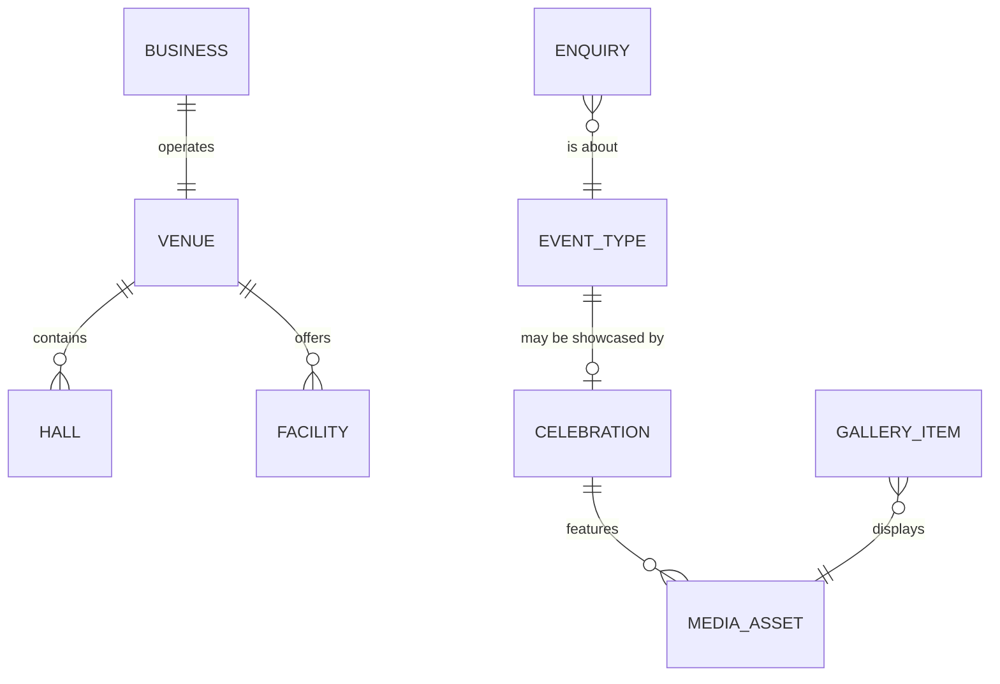
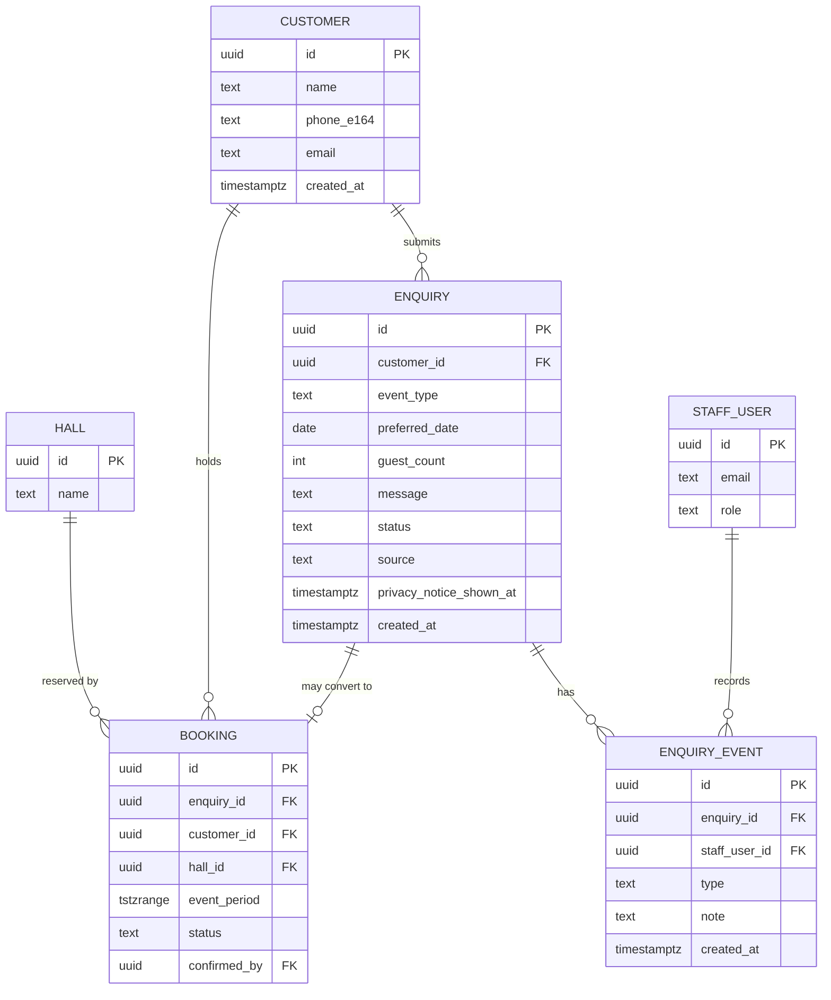

# Data Model

These TypeScript models are **design examples**, not implemented code. Values shown as `null` mean "not verified". Nothing here is a real BAMBOOS fact unless it was stated in the project brief (name, category and locality).

> **Implemented types:** `src/types/domain.ts` is authoritative where it differs from these examples. It adds `Visual` (a real image or a labelled reserved frame, see [ADR-009](ADR/ADR-009-reserved-frames-for-missing-photography.md)), `Venue.specs`, and `Facility.covers`. Facility entries are topics whose `description` stays `null` until confirmed. `MediaAsset.illustrative` marks labelled stock placeholders ([ADR-010](ADR/ADR-010-illustrative-stock-photography.md)).

## 1. Principles

1. **One home per fact.** A value is defined once and imported everywhere else.
2. **`null` means unverified.** UI and JSON-LD omit it, and `check:launch` blocks production if it is launch-required.
3. **Plain, serialisable data.** Models can move to a CMS or database without changing how components receive them.
4. **Types from schemas where validated.** The `Enquiry` type is inferred from Zod, so type and rules can't drift.
5. **Stable ids, separate from labels.** URLs and references don't change when wording does.

## 2. Entities



| Entity | Storage | Purpose |
|---|---|---|
| `BusinessInfo` | `config/business.ts` | Identity, address, geo, hours |
| `ContactInfo` | `config/contact.ts` | Phone, email, WhatsApp |
| `EventType` | `config/event-types.ts` | Enquiry options, safe for the browser |
| `Venue`, `Hall` | `content/venue.ts` | Description and capacity |
| `Facility` | `content/facilities.ts` | Amenities |
| `Celebration` | `content/celebrations.ts` | Category page content |
| `GalleryItem`, `MediaAsset` | `content/gallery.ts`, `src/assets/media/` | Photos and video |
| `Enquiry` | **Not stored.** Exists in browser memory only | Visitor's request |

## 3. Business and contact data

```ts
// src/types/domain.ts
export interface PostalAddress {
  streetAddress: string | null;
  addressLocality: string;
  addressRegion: string;
  postalCode: string | null;
  addressCountry: "IN";
}

export interface BusinessInfo {
  name: string;
  legalName: string | null;
  category: string;
  address: PostalAddress;
  geo: { latitude: number; longitude: number } | null;
  googleMapsUrl: string | null;
  openingHours: OpeningHours[] | null;
}

export interface OpeningHours {
  days: ("Mo" | "Tu" | "We" | "Th" | "Fr" | "Sa" | "Su")[];
  opens: string;  // "09:00"
  closes: string; // "18:00"
}

export interface ContactInfo {
  phoneE164: string | null;       // "+<country code><number>"
  whatsappNumber: string | null;  // Digits only, international format
  email: string | null;
  enquiryHours: string | null;
}
```

```ts
// src/config/business.ts: only brief-stated facts are filled in
export const business: BusinessInfo = {
  name: "BAMBOOS",
  legalName: null,
  category: "Auditorium, Wedding Venue and Event Destination",
  address: {
    streetAddress: null,
    addressLocality: "Aluva",
    addressRegion: "Kerala",
    postalCode: null,
    addressCountry: "IN",
  },
  geo: null,
  googleMapsUrl: null,
  openingHours: null,
};
```

## 4. Venue data

```ts
export interface Hall {
  id: string;
  name: string;
  description: string;
  capacity: {
    seated: number | null;
    dining: number | null;
  };
  images: MediaAsset[];
}

export interface Venue {
  headline: string;
  summary: string;
  halls: Hall[];
  parkingCapacity: number | null;
  images: MediaAsset[];
}
```

`Hall` allows for multiple halls without assuming how many exist. A hall with `null` capacity shows no capacity at all.

## 5. Event categories

Event types and celebration pages are separate, on purpose. `EventType` is small and browser-safe. `Celebration` is rich and imports images, so it stays on the server.

```ts
// src/config/event-types.ts: must not import images or content
export const EVENT_TYPES = [
  { id: "wedding", label: "Wedding" },
  { id: "engagement", label: "Engagement" },
  { id: "reception", label: "Reception" },
  { id: "birthday", label: "Birthday Celebration" },
  { id: "corporate", label: "Corporate Event" },
  { id: "conference", label: "Conference" },
  { id: "other", label: "Other" },
] as const;

export type EventTypeId = (typeof EVENT_TYPES)[number]["id"];
```

```ts
// Used by content/celebrations.ts
export interface Celebration {
  slug: string;           // URL: "weddings"
  eventTypeId: EventTypeId;
  title: string;
  summary: string;
  body: string[];
  heroImage: MediaAsset;
  images: MediaAsset[];
  seo: { title: string; description: string };
}
```

## 6. Facility data

```ts
export interface Facility {
  id: string;
  name: string;
  description: string;
  group: "seating" | "dining" | "stage-av" | "parking" | "guest-comfort" | "other";
  icon: string | null;    // Key mapped to an icon in the facilities feature
  image: MediaAsset | null;
  highlighted: boolean;
}
```

Facilities are a list, so the rule is simple: **an amenity is listed only once BAMBOOS has confirmed it.** The list starts empty.

`icon` stores a key instead of a component, which keeps data serialisable and React-free.

## 7. Media and gallery data

```ts
import type { StaticImageData } from "next/image";

export interface MediaAsset {
  src: StaticImageData | string; // Static import today, CDN URL later
  alt: string;                   // Required
  decorative?: boolean;          // Required to be true when alt is ""
  width?: number;                // Required when src is a string
  height?: number;               // Required when src is a string
  credit?: string;
}

export type GalleryCategory =
  | "wedding" | "engagement" | "reception" | "corporate" | "venue" | "facilities";

export type GalleryItem =
  | { kind: "image"; id: string; category: GalleryCategory; asset: MediaAsset; featured?: boolean }
  | {
      kind: "video";
      id: string;
      category: GalleryCategory;
      title: string;
      poster: MediaAsset;
      source:
        | { type: "file"; mp4: string; webm?: string; captions?: string }
        | { type: "youtube"; videoId: string };
    };
```

## 8. Enquiry data

```ts
// src/schemas/enquiry.ts (design example)
import { z } from "zod";
import { EVENT_TYPES } from "@/config/event-types";

const eventTypeIds = EVENT_TYPES.map((t) => t.id) as [string, ...string[]];

// Removes control characters and trims. Message text remains plain text.
const cleanText = (max: number) =>
  z.string()
    .transform((v) => v.replace(/[\u0000-\u0008\u000B\u000C\u000E-\u001F\u007F]/g, "").trim())
    .pipe(z.string().max(max));

// Blank HTML inputs submit "". Without this, a blank optional date or guest count fails validation.
const emptyToUndefined = (value: unknown) => (value === "" ? undefined : value);

export const enquirySchema = z.object({
  name: cleanText(80).pipe(z.string().min(2, "Please enter your name")),
  phone: z.string().trim()
    .regex(/^\+?[0-9\s()-]{8,20}$/, invalidPhone)
    .refine((value) => /^\d{8,15}$/.test(value.replace(/\D/g, "")), invalidPhone),
  eventType: z.enum(eventTypeIds),
  preferredDate: z.string().min(1).pipe(z.iso.date()),
  guestCount: z.preprocess(emptyToUndefined, z.coerce.number().int().min(1).max(100000)),
  message: cleanText(300).optional(),
});

export type Enquiry = z.infer<typeof enquirySchema>;
```

| Field | Required | Notes |
|---|---|---|
| `name` | Yes | 2–80 characters. No format restriction beyond that: names vary widely |
| `phone` | Yes | International format with 8–15 digits. Not limited to `+91` |
| `eventType` | Yes | Preselected from a validated `?event=` value. Unknown values are ignored |
| `preferredDate` | Yes | "Preferred", never "booked". The "not in the past" check is applied in the form using the visitor's local date, with an injected clock for tests |
| `guestCount` | Yes | A positive whole number. An estimate is fine |
| `message` | No | Limited to 300 characters to keep the URL within budget |

**Data minimisation:** no email, address or budget field is collected. Staff can ask in the conversation.

### Handoff result

```ts
export type EnquiryHandoff =
  | { ok: true; url: string; message: string }
  | { ok: false; reason: "whatsapp-not-configured" | "message-too-long" };
```

## 9. Environment variables

| Variable | Exposure | Required | Purpose |
|---|---|---|---|
| `NEXT_PUBLIC_SITE_URL` | Public, inlined at build | Yes | Canonical URLs, `metadataBase`, sitemap |
| `VERCEL_ENV` | Set by platform, server/build only | On Vercel | Controls robots rules |

The WhatsApp number is deliberately **not** an environment variable. It's a public business fact, and needs to be reviewable in one place.

## 10. Current storage

| Aspect | Approach |
|---|---|
| Location | TypeScript in Git; images in `src/assets/media` |
| Change process | Pull request, preview review, merge, automatic deployment |
| History and rollback | Git and Vercel deployments |
| Validation | TypeScript at build; content tests for slugs, alt text and duplicate ids |
| Access | Async `get*()` functions, called by routes |

```ts
// src/content/celebrations.ts: the only seam a future CMS needs
export async function getCelebrations(): Promise<Celebration[]> {
  return celebrations;
}
export async function getCelebrationBySlug(slug: string): Promise<Celebration | undefined> {
  return celebrations.find((c) => c.slug === slug);
}
```

## 11. Future migration

### To a CMS

**Trigger:** staff need to change content without a developer, more often than a developer can reasonably handle.

| What changes | What doesn't |
|---|---|
| Internals of `get*()` functions | Route structure and page composition |
| `MediaAsset.src` becomes URL, with width and height | Feature components and their props |
| `images.remotePatterns` for the CMS's image host | Type shapes, largely |
| CSP `img-src` | SEO builders |
| Webhook-triggered revalidation (`cacheComponents` and `cacheTag`, or equivalent) | Enquiry flow |
| `dynamicParams = false` replaced, so new slugs work without a rebuild | |

`config/` facts can stay in code. Only move them if staff really need to edit them.

### To a database

**Trigger:** enquiries, customers or bookings must be recorded. Illustrative PostgreSQL model. **Proposed for the future, not implemented:**



**Key rules for that future:**

- Enquiry status: `new → contacted → quoted → converted | closed`.
- Booking status: `tentative → confirmed → completed | cancelled`.
- Only an authenticated staff action can confirm a booking.
- A PostgreSQL exclusion constraint on `(hall_id, event_period)` prevents double-booking for confirmed bookings at the database level.
- Availability is **derived** from bookings, never stored separately.
- A retention period for personal data must be defined and enforced before storing any.

| What changes | What doesn't |
|---|---|
| Add `src/server/`, schema migrations, `(admin)` routes | Public pages and content |
| Form submit also calls a Server Action | `enquirySchema` (reused on the server) |
| Backend security controls ([SECURITY.md](SECURITY.md#9-future-backend-security)) | WhatsApp services |
