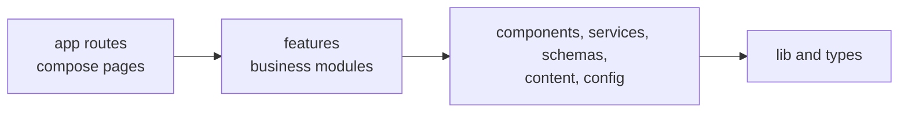

# BAMBOOS Premium Auditorium Website

Website for BAMBOOS, an auditorium, wedding venue and event destination in Aluva, Ernakulam, Kerala. It showcases the venue, supports local search visibility, and turns visitors into booking enquiries through WhatsApp.

> **Current status: frontend built, not launched.** All pages and the enquiry flow are implemented. **Launch is blocked until BAMBOOS supplies verified business facts and licensed media**: `npm run check:launch` lists exactly what is missing. Marked placeholders and clearly labelled stock photographs appear until then. **No photograph on the site currently shows BAMBOOS.**

An **enquiry is not a booking**. The website prepares enquiries only, and BAMBOOS staff confirm any booking.

## Technology stack

| Area | Technology | State |
|---|---|---|
| Framework | Next.js 16.4 (App Router), React 19, TypeScript strict | Installed |
| Styling | Tailwind CSS 4, CSS variable design tokens | Installed |
| Linting | ESLint 9, Next.js config | Installed |
| Forms | React Hook Form, Zod | Installed |
| Testing | Vitest, React Testing Library, Playwright, axe | Installed |
| Animation, icons | CSS and small scripts, inline SVG. No animation or icon library needed | In use |
| Hosting | GitHub, Vercel Pro | Planned, needs client approval |

Details and alternatives are in [TECH_STACK.md](TECH_STACK.md).

## Architecture overview

A **feature-based modular monolith** with **fully prerendered pages**. There is no database or backend in release 1.



- **Routes compose. Features never import each other.** ESLint enforces this.
- **Server Components by default**, with small client islands for the form, gallery and navigation.
- **Enquiries stay in the browser** until the visitor opens the prepared WhatsApp message and sends it.
- **Unverified facts are `null`**: they're left off the site, and launch is blocked until required ones are supplied.

## Folder structure

Folders are created when first needed, so `hooks/`, `assets/media/` and `public/media/video/` will appear with their first files.

```text
src/
├── app/                 # Routes, layouts, boundaries, sitemap, robots
│   └── (site)/          # /, /venue, /celebrations, /gallery, /facilities, /contact, /privacy
├── features/            # home, venue, celebrations, gallery, facilities, enquiries, contact
├── components/          # ui, layout, motion, media
├── config/              # Business, contact, event types, navigation, SEO, social, env
├── content/             # Venue, facilities, celebrations, gallery data
├── assets/media/        # Statically imported images
├── services/            # WhatsApp URL and enquiry handoff
├── schemas/             # Zod validation
├── types/               # Shared domain types
├── hooks/               # Shared hooks
└── lib/                 # SEO builders and helpers
public/media/video/      # Self-hosted video
tests/e2e/               # Playwright journeys
ADR/                     # Decision records
```

See [ARCHITECTURE.md](ARCHITECTURE.md#10-folder-structure) for what belongs in each directory.

## Documentation

| Document | Contents |
|---|---|
| [ARCHITECTURE.md](ARCHITECTURE.md) | Full solution architecture with diagrams, validation and review |
| [PROJECT_SCOPE.md](PROJECT_SCOPE.md) | Objectives, requirements, scope, assumptions, **content verification register** |
| [TECH_STACK.md](TECH_STACK.md) | Technology evaluation |
| [DATA_MODEL.md](DATA_MODEL.md) | Entities, TypeScript models, CMS and database migration |
| [API_DESIGN.md](API_DESIGN.md) | WhatsApp integration; proposed future APIs |
| [SECURITY.md](SECURITY.md) | Threats, privacy, CSP, future backend security |
| [TESTING_STRATEGY.md](TESTING_STRATEGY.md) | Test levels, priorities, quality gates, CI |
| [DEPLOYMENT.md](DEPLOYMENT.md) | Environments, Git workflow, domain setup, rollback |
| [ADR/](ADR/README.md) | Architecture decision records |
| [ASSET_ATTRIBUTION.md](ASSET_ATTRIBUTION.md) | Image sources and licences |
| [AGENTS.md](AGENTS.md) | Instructions for AI coding agents |

## Prerequisites

- Node.js 24 (pinned in `.nvmrc` and `package.json`).
- npm 11 or later.
- Git.

## Initial setup

```bash
git clone <repository-url>
```

```bash
cd bamboo_website
```

```bash
npm ci
```

```bash
npm run dev
```

Open [http://localhost:3000](http://localhost:3000).

No environment variables are required locally. See `.env.example`. For browser tests, also run `npx playwright install chromium webkit`.

## Development commands

| Command | Purpose |
|---|---|
| `npm run dev` | Start the development server |
| `npm run build` | Create a production build |
| `npm run start` | Serve the production build |
| `npm run lint` | Run ESLint, including architecture boundaries |
| `npm run typecheck` | Generate route types and type-check |
| `npm run test` | Unit and component tests in watch mode |
| `npm run test:run` | Unit and component tests, once |
| `npm run test:coverage` | Tests with coverage thresholds |
| `npm run test:e2e` | Build, then run browser tests on four device profiles |
| `npm run check:static` | After a build: fail if any route renders per request |
| `npm run check:launch` | List what must be verified or supplied before launch. **Expected to fail today** |

## Replacing placeholders

- **Business facts:** `src/config/business.ts`, `contact.ts` and `social.ts`.
- **Venue details and facilities:** `src/content/venue.ts` and `facilities.ts`.
- **Stock photographs:** listed in [ASSET_ATTRIBUTION.md](ASSET_ATTRIBUTION.md). Replace them all before launch.
- **Photography:** put files in `src/assets/media/`, import them in `src/content/`, and replace a `pending` visual with `{ kind: "image", asset: { src, alt } }`. The `brief` on each pending frame is the shot list.
- **Hero film:** add files to `public/media/video/` and set `venue.heroVideo`.
- A test in `src/content/content.test.ts` deliberately fails when a contact or capacity value changes, as a prompt to confirm it was verified. Update it in the same change.

## Contributing

This project uses Next.js 16, which has breaking changes from earlier versions. Check the guides in `node_modules/next/dist/docs/` before writing code.

Work on a short-lived branch, open a pull request against `main`, and pass all [quality gates](TESTING_STRATEGY.md#6-quality-gates). **Never add a capacity, amenity or contact detail that BAMBOOS hasn't verified.**
